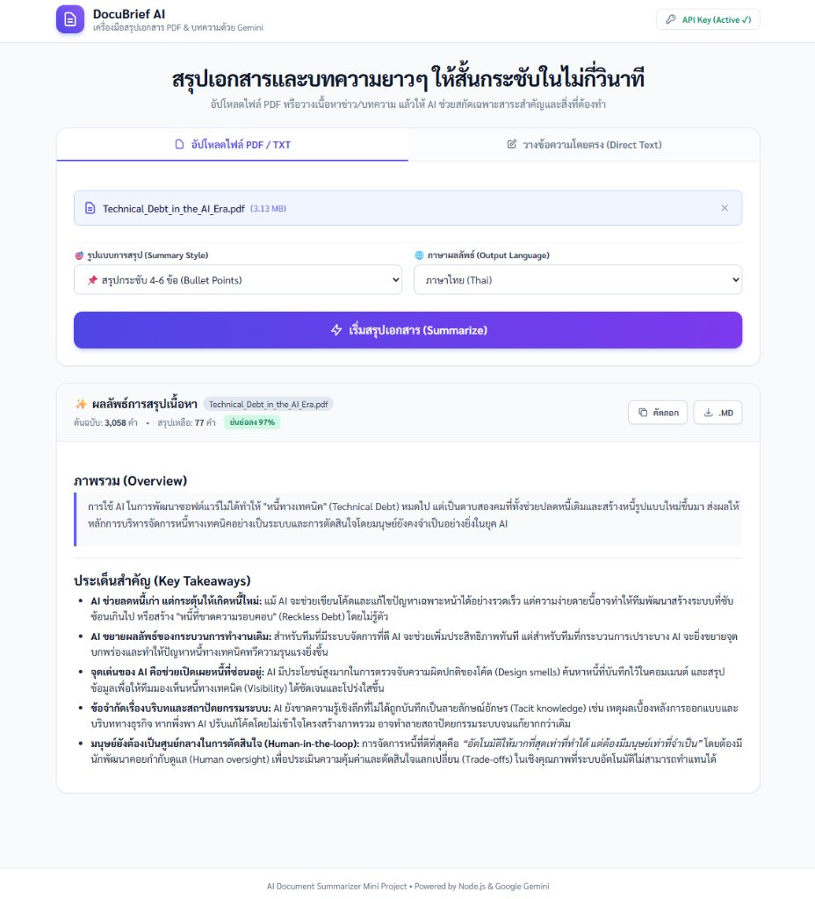

# 📄 DocuBrief AI - AI Document & Article Summarizer

<p align="center">
  
  
  
  
  
</p>

---

## 📸 ภาพตัวอย่างการใช้งาน (App Preview)



**DocuBrief AI** เป็นเว็บแอปพลิเคชัน Full-stack สำหรับสกัดและสรุปใจความสำคัญจากเอกสาร PDF หรือบทความขนาดยาว ช่วยลดระยะเวลาในการอ่านข้อมูลได้สูงสุดถึง **97%** พัฒนาด้วย Node.js, Express และเชื่อมต่อกับ **Google Gemini 3.8 Flash**

---

## ✨ ฟีเจอร์หลัก (Key Features)

* **📁 รองรับการป้อนข้อมูล 2 รูปแบบ:**
  * **Upload File (.pdf / .txt):** ระบบประมวลผลไฟล์และถอดข้อความแบบ In-Memory ปลอดภัยและรวดเร็ว
  * **Direct Text Paste:** วางข้อความบทความ/ข่าว พร้อมปุ่มกด *"ลองใช้ข้อความตัวอย่าง 💡"* เพื่อทดสอบทันที
* **🎯 เลือกสไตล์การสรุปได้ 4 รูปแบบ:**
  * 📌 **Bullet Points:** สรุปกระชับ 4-6 ข้อ เน้นประเด็นสำคัญ
  * 🚀 **Action Items:** สรุปประเด็นหลัก พร้อมเช็กลิสต์สิ่งที่ต้องนำไปทำต่อ (To-Do List)
  * 📖 **Detailed:** สรุปเจาะลึก แยกหมวดหมู่อย่างเป็นระเบียบ
  * ❓ **Q&A:** สรุปในรูปแบบถาม-ตอบสำหรับทบทวน
* **🌐 รองรับภาษา:** สรุปผลลัพธ์เป็นภาษาไทย (Thai) หรือ English
* **📊 สถิติความย่นย่อ (Summary Stats):** คำนวณจำนวนคำเดิม vs จำนวนคำที่สรุป พร้อมระบุเปอร์เซ็นต์การย่นย่อ
* **⚡ Productivity Shortcuts:**
  * กด `Ctrl + Enter` (หรือ `Cmd + Enter`) เพื่อสั่งสรุปได้ทันที
  * ปุ่มคัดลอกลง Clipboard เพียง 1 คลิก
  * ปุ่มดาวน์โหลดผลลัพธ์เป็นไฟล์ Markdown (`.md`)
* **🛡️ Built-in Demo Mode:** สามารถทดสอบระบบได้ทันทีแม้ยังไม่ได้ใส่ API Key

---

## 🏗️ สถาปัตยกรรมระบบ (System Architecture)

```
[ User Browser ]
   │
   ├── 1. Drag & Drop PDF / Paste Text
   ├── 2. Client-side Validation & API Key Storage (localStorage)
   ▼
[ Express.js Server (Port 3000) ]
   │
   ├── In-Memory Stream Processing (Multer)
   ├── PDF Text Extraction (pdf-parse)
   ├── Prompt Engineering Engine
   ▼
[ Google Gemini API (v1beta / v1) ]
   │  └── Primary: gemini-3.8-flash
   │  └── Fallbacks & Dynamic Discovery (ListModels)
   ▼
[ Markdown Formatted Output & Analytics ]
```

---

## 🛠️ จุดเด่นทางเทคนิค (Engineering Highlights)

1. **Multi-Model Fallback & Dynamic Discovery:** ป้องกันปัญหา API Deprecation ด้วยระบบลองเชื่อมต่อโมเดลล่าสุด (`gemini-3.8-flash`, `gemini-2.5-flash`) และมีระบบค้นหาโมเดลที่มีสิทธิ์ผ่าน `ListModels` อัตโนมัติ
2. **In-Memory Buffer Processing:** ไม่บันทึกไฟล์ชั่วคราวลงในฮาร์ดดิสก์ของเซิร์ฟเวอร์ ลดความเสี่ยงด้านความปลอดภัยและพื้นที่จัดเก็บ
3. **Zero-leak Client Key Architecture:** API Key ถูกเก็บใน LocalStorage บนเครื่องผู้ใช้ ไม่มีการฮาร์ดโค้ดคีย์ลงใน Repository

---

## 🚀 วิธีติดตั้งและรันในเครื่อง (Getting Started)

### 1. โคลน Repository
```bash
git clone https://github.com/Sparkie2805/ai-document-summarizer.git
cd ai-document-summarizer
```

### 2. ติดตั้ง Dependencies
```bash
npm install
```

### 3. รันเซิร์ฟเวอร์
```bash
npm start
```

### 4. ใช้งานผ่านเบราว์เซอร์
เปิดเบราว์เซอร์แล้วไปที่: **http://localhost:3000**

---

## 🔑 การตั้งค่า Gemini API Key (ฟรี)

1. ขอรับ API Key ฟรีได้ที่ [Google AI Studio](https://aistudio.google.com/app/apikey)
2. นำคีย์มากรอกได้ 2 วิธี:
   * **ผ่านหน้าเว็บ:** คลิกปุ่ม **"API Key"** ที่มุมขวาบนของหน้าเว็บ (ระบบจะจำไว้ในเบราว์เซอร์)
   * **ผ่านไฟล์ .env:** คัดลอก `.env.example` เป็น `.env` แล้วระบุ:
     ```env
     GEMINI_API_KEY=AIzaSy...
     PORT=3000
     ```

---

## 📄 License
This project is licensed under the MIT License - see the [LICENSE](LICENSE) file for details.
